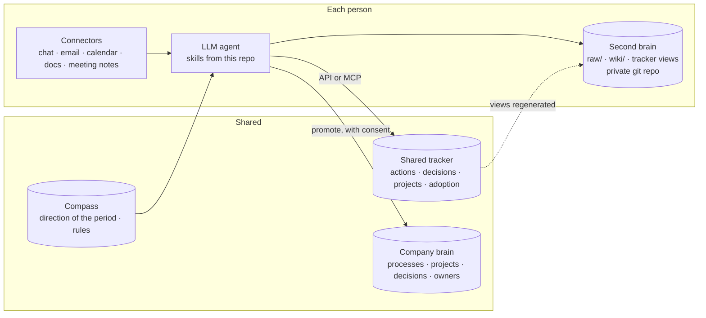

# Open Company OS

An open blueprint for giving every person in a company a personal LLM manager that reads their sources, keeps a private second brain, and writes actions and decisions into one shared tracker, so the whole company runs on the same protocol.

Open Company OS is the people-and-work half of a pair. [Open Company Cloud](https://github.com/Estoca/open-company-cloud) is the single-box company cloud where internal apps run. The OS assumes a company cloud exists: a git host with identity for every person's private repo, a place to run the shared tracker behind SSO, and an MCP endpoint that knows who is calling. Open Company Cloud is the reference one and the cheapest we know; if you already have those three, the OS runs on them. The cloud runs fine without the OS. It is ready to try: a coding agent installs it on a clean box from a layperson's request in about 8 minutes and puts a new app on the air in about 2 ([test records](https://github.com/Estoca/open-company-cloud/blob/main/docs/first-run.md), [try it in 10 minutes](https://github.com/Estoca/open-company-cloud/blob/main/docs/try-it.md)).

## What This Is

A coding agent with connectors (chat, email, calendar, documents, meeting notes) can already read everything a person deals with in a day. What it lacks is a protocol: where to put what it finds, what counts as an action, who is allowed to see it, how to prioritize, and what it must never do on its own.

None of the pieces below is new on its own. Personal LLM wikis are widespread. Company wikis of processes and policies are common. Task trackers exist. What we have not found anywhere is the union: every person required to have the second brain, their open loops flowing into a shared tracker, each one confirmed by the person inside the ritual, without exposing anything private, and priority coming from one versioned document that scales to the whole company. Open Company OS is that union, written down as a protocol. The reference software that runs it (agent skills, a tracker service, an MCP server) exists internally and is being extracted into this repository piece by piece; today the repository is the paper. The pieces:

- a **second brain** per person: a private, versioned wiki the agent maintains from raw sources (the LLM wiki pattern Andrej Karpathy described), with a fixed classification of everything that comes in;
- a **shared tracker**: the single source of truth for open loops, commitments and decisions across the company, written by every person's agent through one API;
- a **company brain**: the shared repository of processes, projects, decisions taken and owners, where private knowledge is promoted item by item, with consent;
- a **compass**: a versioned file that states the company's priorities for the period and the rules every agent follows to rank work and to act (what it drafts, what it executes, what it never does);
- **rituals**: a morning package and an evening close for each person, a weekly close, and a meeting prep/ingest flow, each a skill the agent runs when asked.

It is not a hosted product. It is a set of protocols, schemas, templates and a reference implementation (agent skills, a tracker service, an MCP server) that a company adapts to its own tools. The reference implementation runs on Claude Code (skills packaged as a plugin, connectors and the tracker reached through MCP). The protocols do not depend on it: any agent that can read the person's sources, run a skill-like procedure and call an API can follow them.

## Why It Exists

Personal assistants built on LLMs stall at the boundary of one person. Each assistant has its own idea of what an open loop is, keeps it in its own notes, and nobody else's assistant can see it. The manager's assistant and the report's assistant do not agree on what is pending.

The protocol moves that boundary. Every agent writes actions to the same tracker with the same fields and the same rules (one person per action, one deliverable per action, evidence required to close, SLA by severity). Every agent reads the same compass before ranking a person's day. The company gets one picture of what is pending, who is waiting on whom, and which decisions are stuck, without anyone filling in a tool by hand.

Two rules make this safe enough for a whole company:

- **Private by default, shared by protocol.** Raw sources and the wiki are the person's. Only actions, decisions and what is explicitly promoted leave that boundary, and sensitive content never does.
- **The agent drafts; the person sends.** The agent never sends a message, an email or an invite on its own, never acts in someone else's name, never deletes. The only exception is the person asking for that one message, at that moment. Delegation levels are published in the compass and only change there.

## Architecture



Layers, from private to shared:

| Layer | Who writes | What it is | Doc |
|---|---|---|---|
| Raw sources | the agent, from connectors | Immutable dumps of threads, emails, meeting notes | [second-brain.md](docs/second-brain.md) |
| Second brain (wiki) | the agent | People, projects, meetings, topics, daily and weekly notes. Private. | [second-brain.md](docs/second-brain.md) |
| Shared tracker | every agent, by protocol | Actions and decisions of everyone. Views regenerated into each repo. | [tracker.md](docs/tracker.md) |
| Company brain | the agent, only via promotion | Processes, projects, decisions taken, owners. Company-wide. | [privacy.md](docs/privacy.md) |
| Compass | leadership, by hand or skill | Priority criteria, delegation levels, direction of the period, signals, never-list | [compass.md](docs/compass.md) |
| Skills | this repo | Step by step for each ritual | [rituals.md](docs/rituals.md) |

The full picture, including how the OS runs on Open Company Cloud, is in [architecture.md](docs/architecture.md). What has already made an agent go wrong, and the rule each incident produced, is in [pitfalls.md](docs/pitfalls.md).

## The Four Protocols

1. **[Second brain](docs/second-brain.md)**: layers, sources, the six-way classification of every incoming item, writing conventions (facts only with a source, corrections keep the old text).
2. **[Shared tracker](docs/tracker.md)**: fields, rules (one person, one deliverable, evidence to close, SLA by severity, reassign never recreate), how views are regenerated and how the agent behaves without the tracker.
3. **[Compass](docs/compass.md)**: the ranking criteria, the delegation ladder, the direction of the period as a versioned table, management signals, and the never-list.
4. **[Privacy and promotion](docs/privacy.md)**: what stays private, what is `sensitive`, how an item is promoted to the company brain, and the consent rule for decisions.

## Target Agent Experience

The intended install experience mirrors Open Company Cloud:

```text
A person sends this repository URL to a terminal-connected LLM.
The LLM reads the repo, explains the protocol, asks which connectors and tracker to use, creates the person's second brain from the template, writes the schema file, runs the first sweep, and leaves a morning package ready for tomorrow.
```

The company side (tracker, company brain, compass) is set up once by whoever runs the rollout. The person side is set up by each person with their own agent, without help. The pilot showed that "without help" is where it breaks, so the install contract is written to be followed by an LLM, not a human. The contract itself, `docs/agent-setup-contract.md`, is roadmap item 2 and not written yet.

## Results So Far

Built and used at Estoca, a logistics company in Brazil, before being generalized here. Numbers come from the tracker's own adoption counter (a person's morning package counts as opened when their agent requests the daily digest).

| When | What |
|---|---|
| 2026-09-21 | Protocol and skills stable for one person; pilot started with two more |
| 2026-09-28 | 7 people opening the daily package |
| 2026-10-08, 09 | Company-wide rollout over two days |
| 2026-10-09 | 56 of 73 active people opened the package on day two |
| 2026-10-08 to 14 | 94% of expected daily packages opened (214 of 228) |

How "expected" is counted: a person enters the count on the first day they open a package and stays in it on every working day after that, minus recorded absences. Most people's first day was 08 or 09-10, so the week has fewer expected packages than 73 people times five days.

What the rollout cost: two days in which the company's regular meetings were cancelled so that everyone could set up with their own agent, with two people (one founder and the agent itself) on call for help; most of the help went to Windows machines and to people who had never opened a terminal. Per-person running cost is the agent subscription plus the tokens of two rituals a day; we have not measured the tokens yet and will publish them with the outcome metrics.

What this does not show yet: whether loops close faster or decisions get unstuck sooner. Those are the outcome metrics (time to close, bumps per action, decisions past deadline) and they are the next thing we will publish.

## Status

This repository starts as the paper: the protocols and the architecture, generalized from a working internal implementation. The reference software (agent skills as a plugin, the tracker service, the MCP server, the second-brain template) is being extracted next. See [ROADMAP.md](ROADMAP.md).

## Repository Layout

```text
docs/architecture.md     how the pieces fit, and how the OS runs on Open Company Cloud
docs/second-brain.md     protocol 1: the per-person wiki
docs/tracker.md          protocol 2: the shared tracker
docs/compass.md          protocol 3: direction and rules
docs/privacy.md          protocol 4: privacy, sensitive content, promotion
docs/rituals.md          morning package, evening close, weekly close, meetings
docs/pitfalls.md         incidents that produced rules
templates/               compass constitution, direction file, second-brain schema
ROADMAP.md               what is extracted next
```

## License

MIT. See [LICENSE](LICENSE).
