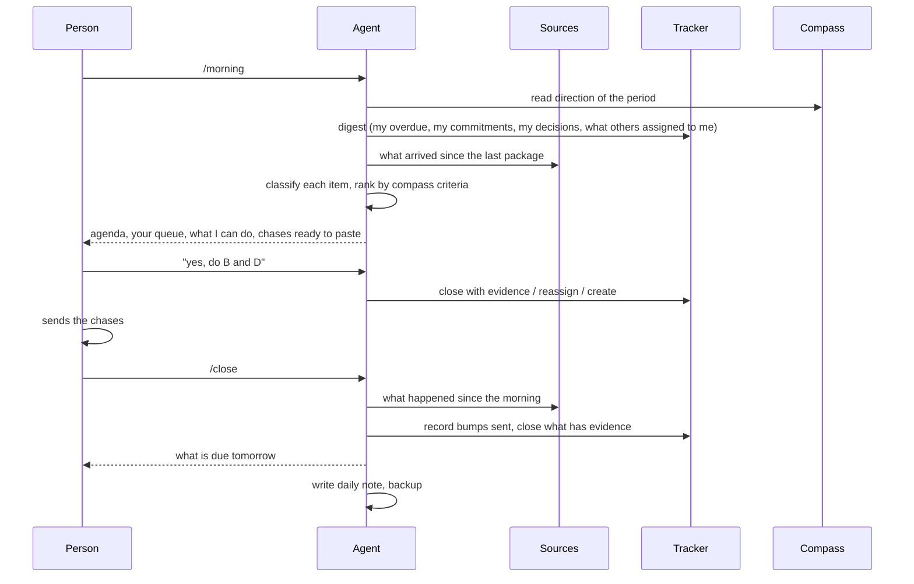

# Architecture

## Roles

Three roles, and the protocol is mostly about keeping them apart.

| Role | Does | Does not |
|---|---|---|
| The person | captures, asks, decides, sends | summarize, file, cross-reference, chase |
| The agent | reads sources, classifies, writes the second brain, writes the tracker, drafts messages, ranks the day | send anything, decide anything, act for someone else, delete |
| Leadership | writes the compass (direction, weights, delegation levels) | configure each person's agent |

"The agent is the maintainer. The person captures, asks and decides. Everything else is the agent's." Nothing the person's agent does runs unattended: every operation is triggered by the person, and every write to the tracker is confirmed by them inside the ritual (one confirmation per item, or per batch when the agent lists the batch first). Git is backup only, with no automation on the person's repo. Company-side administration (adding a new hire to the readers of the company brain, provisioning a repo) is ordinary automation and is not covered by this rule.

## Pieces

**Per person**

- *Connectors*: the agent reads chat, email, calendar, documents and meeting notes through the person's own accounts, with the person's own permissions. Connectors are configured per person, not in the repo.
- *Second brain*: one private git repo per person. `raw/` is immutable; `wiki/` is the agent's; `tracker/` holds regenerated views of the shared tracker; the schema file (`CLAUDE.md` or equivalent) is the contract between the person and the agent. Protocol in [second-brain.md](second-brain.md).
- *Skills*: the rituals, installed as an agent plugin. They read the schema file and the compass before doing anything. [rituals.md](rituals.md).

**Shared**

- *Tracker*: a small service with an API. Actions (loops and commitments), decisions, projects, suggestions and their outcomes, adoption. Every agent writes to it under the identity of the person it serves. [tracker.md](tracker.md).
- *Company brain*: a git repo of processes, projects, decisions taken and owners. Written only by promotion from a second brain, item by item. [privacy.md](privacy.md).
- *Compass*: a repo with one versioned file. Read by every agent before ranking; written by leadership. [compass.md](compass.md).
- *MCP server*: how the agent reaches the tracker and the company brain. The caller is identified by login, so writes are attributed without configuration.

## Data Flow of One Day

## Trust Boundaries

| Boundary | Rule |
|---|---|
| Sources → second brain | `raw/` is never edited. A wrong source gets a correction in the wiki with `supersedes:`, the original stays. |
| Second brain → tracker | Only actions and decisions cross. Sensitive items cross with a neutral title; detail stays private. |
| Second brain → company brain | Only by explicit promotion. Decisions need the consent of whoever decided. `sensitive` never crosses. |
| Agent → the world | Nothing is sent on the agent's initiative. Drafts only; the one exception is the person asking for that message, at that moment. |
| Agent → tracker | Every write under the person's identity. Close and decide name the item they target (`expect_title_contains`), so a wrong id is an error, not a silent wrong close. |

## Running on Open Company Cloud

The OS does not need [Open Company Cloud](https://github.com/Estoca/open-company-cloud). It needs: a git host for second brains and the company brain, a place to run the tracker service, and a way for agents to reach it. The cloud provides all three on one box (Gitea, Docker Compose, SSO in front of the tracker), and the tracker ships with the cloud's app manifest so it deploys like any other internal app. If you already have GitHub, a container platform and SSO, use those.

What the OS adds to a cloud install is the reason the cloud exists: a steady stream of small internal apps, requested by agents on behalf of people, each one with an owner and a contract.

## Adopting Separately

- **Cloud without OS**: a company cloud for internal apps, with nothing about personal agents, trackers or rituals. Fully independent.
- **OS without the cloud**: possible, but only if you already have what the cloud provides: a git host with per-person identity, a container runtime behind SSO for the tracker, and an identity-aware MCP endpoint. Most companies under a few hundred people do not, which is why the two projects were built together and why the OS install contract assumes a company cloud is in place.
- **Both**: the tracker is the first reference app on the cloud; the company brain and the compass are repos on its git host; SSO identifies the caller for the MCP server.
